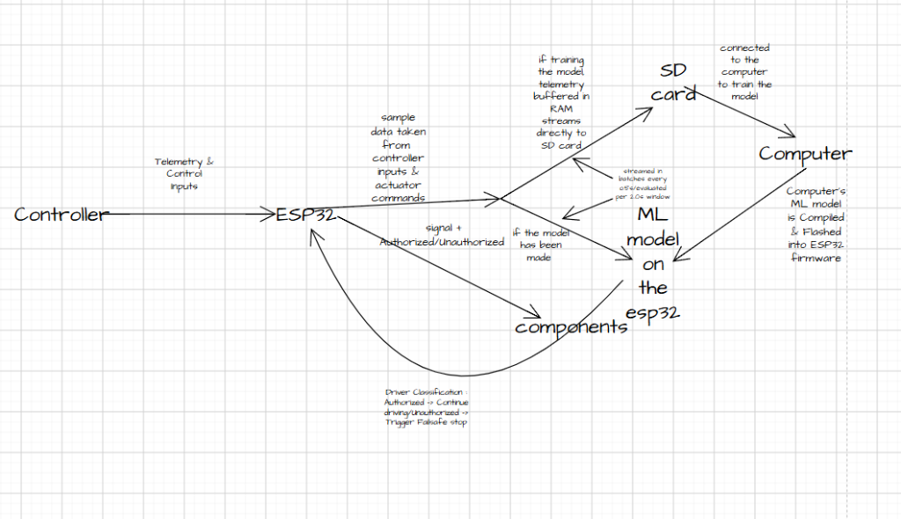
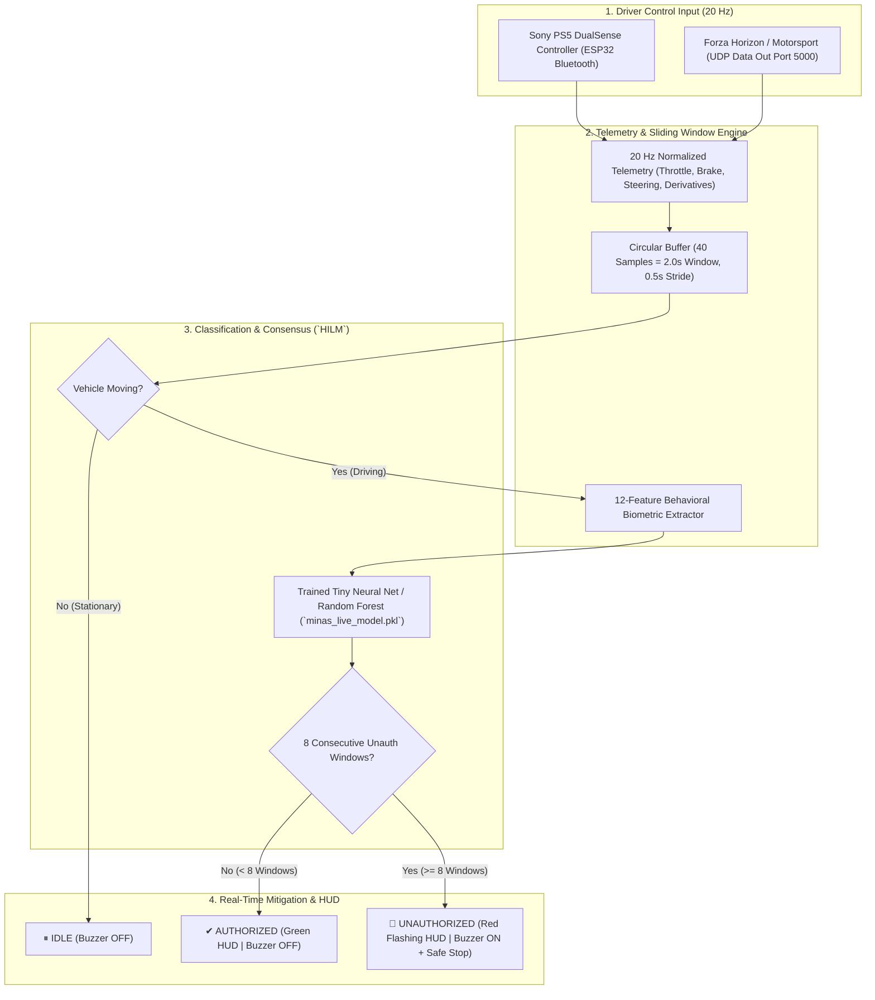
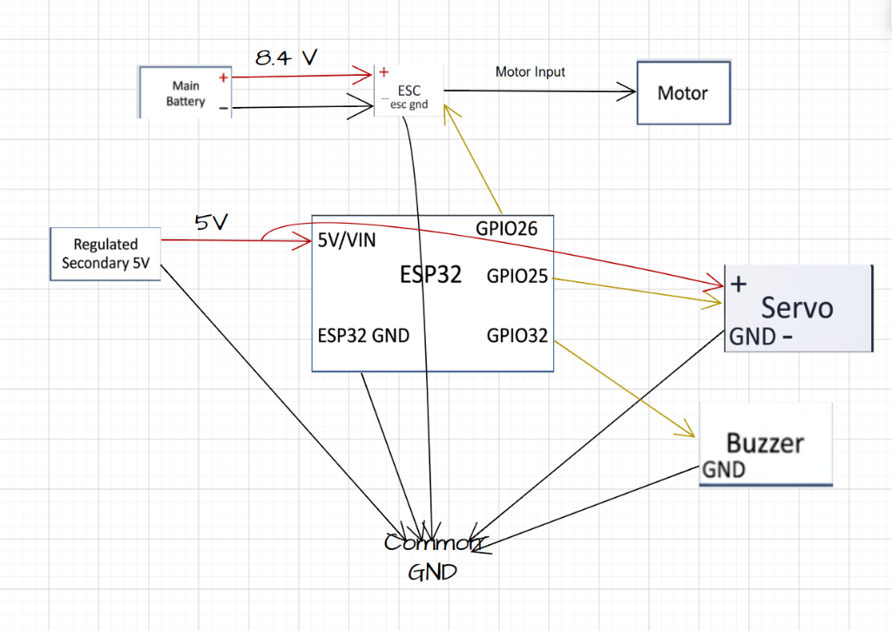
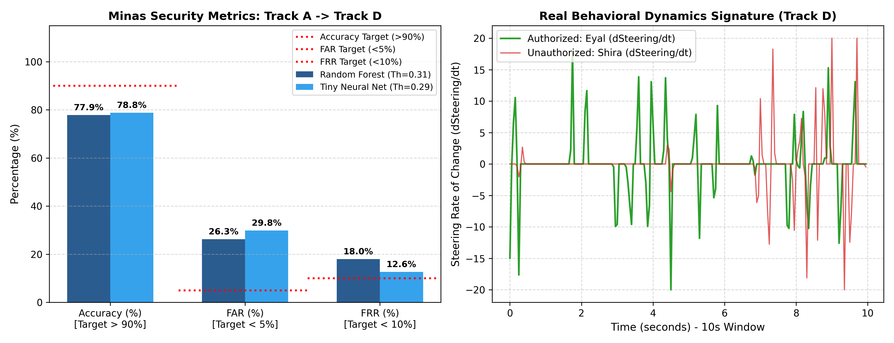

# Minas: Continuous Driver Authentication Using Behavioral Biometrics & TinyML

[](https://platformio.org/)
[](https://isocpp.org/)
[](https://scikit-learn.org/)
[](#%EF%B8%8F-real-time-biometric-guard-poc--forza-telemetry)
[](LICENSE)

An autonomous cyber-physical security system that continuously authenticates a vehicle driver in real time using **Neuromotor Behavioral Biometrics** and **TinyML (Tiny Machine Learning)**—combining an **ESP32-WROVER** embedded platform for physical RC vehicles with a **Hardware-in-the-Loop / Live Forza UDP Biometric Guard (`HILM`)**.

---

## 📑 Table of Contents
1. [Executive Summary & Vision](#-executive-summary--vision)
2. [End-to-End System Architecture & Data Flow](#-end-to-end-system-architecture--data-flow)
3. [Hardware Architecture & Electrical Wiring](#-hardware-architecture--electrical-wiring)
4. [Vehicle Control Scheme & PS5 Integration](#-vehicle-control-scheme--ps5-integration)
5. [Experimental Protocol & Multi-Track Evaluation](#-experimental-protocol--multi-track-evaluation)
6. [Telemetry Schema & 12-Feature Behavioral Signature](#-telemetry-schema--12-feature-behavioral-signature)
7. [Machine Learning Pipeline (`HILM/model.py`)](#-machine-learning-pipeline-hilmmodelpy)
8. [Real-Time Biometric Guard PoC & Forza Telemetry (`HILM/live_detector.py`)](#%EF%B8%8F-real-time-biometric-guard-poc--forza-telemetry-hilmlive_detectorpy)
9. [Firmware Architecture & Hardware Timer Safety](#%EF%B8%8F-firmware-architecture--hardware-timer-safety)
10. [Build, Flash & Verification Guide](#%EF%B8%8F-build-flash--verification-guide)
11. [Repository Structure](#-repository-structure)
12. [Academic References & License](#-academic-references--license)

---

## 🚀 Executive Summary & Vision

Traditional automotive anti-theft security relies on **one-time static authentication at startup** (physical keys, smart fobs, or immobilizers). Once the vehicle is in motion, static authentication fails against:
* **Relay Attacks & Key Cloning:** Stolen or relayed credentials grant full operational control.
* **Mid-Session Carjacking & Handover:** If an unauthorized person takes the wheel while the vehicle is already running, static systems cannot detect the change of driver.
* **Privacy-Invasive Cameras:** Cabin-facing biometric cameras raise privacy concerns and struggle with lighting or occlusions.

### The Minas Solution: Zero-Trust Continuous Behavioral Biometrics
**Minas** introduces an active, non-intrusive security gatekeeper based purely on **how the driver operates the controls**:
1. **Neuromotor Behavioral Biometrics:** Every human driver exhibits a subconscious motor signature—steering micro-corrections, pedal onset rates, braking transitions, and derivative profiles ($\Delta\text{Steering}/\Delta t$, $\Delta\text{Throttle}/\Delta t$).
2. **Track-Invariant Feature Extraction:** By focusing on control derivatives, micro-correction reversals, and pedal aggression rather than raw steering angles, the model recognizes the driver even on **completely unseen tracks**.
3. **Active Cyber-Physical Mitigation:** When **8 consecutive sliding windows** ($4.0\text{ seconds}$) confirm an unauthorized driver, the system triggers an acoustic alarm buzzer and neutralizes vehicle actuation.

---

## 🔄 End-to-End System Architecture & Data Flow

The project operates across both an **ESP32-WROVER Physical RC Platform** and a **Real-Time HILM / Forza Telemetry Proof-of-Concept (PoC)**:





---

## ⚡ Hardware Architecture & Electrical Wiring

Reliable operation of high-current RC actuators alongside an RF-sensitive ESP32-WROVER microcontroller requires clean electrical isolation and a unified ground plane.



### Complete Wiring & Pinout Table (`include/Config.h`)

| Peripheral | Board Pin | Electrical Spec | Subsystem Function |
|---|---|---|---|
| **Steering Servo Signal** | `GPIO 25` | 3.3V Logic PWM (50 Hz, 1000–2000 µs) | Controls steering angle ($0^\circ$ to $180^\circ$, neutral $90^\circ$). |
| **ESC Throttle Signal** | `GPIO 26` | 3.3V Logic PWM (50 Hz) | Electronic Speed Controller throttle ($1000\,\mu\text{s}$ to $2000\,\mu\text{s}$, neutral $1500\,\mu\text{s}$). |
| **Piezo Buzzer (+)** | `GPIO 32` | 3.3V Square Wave (`safeBeep`) | Acoustic feedback without LEDC timer hijacking. |
| **MicroSD Card Bus** | `GPIO 2, 14, 15` | 1-bit Hardware SDMMC | High-speed 20 Hz telemetry logging (D0: GPIO 2, CLK: GPIO 14, CMD: GPIO 15). |
| **Internal SPI PSRAM** | `GPIO 16, 17` | Reserved (Do Not Wire!) | Dedicated to 4MB onboard Pseudo-Static RAM. |
| **Internal SPI Flash** | `GPIO 6–11` | Reserved (Do Not Wire!) | Dedicated to onboard 4MB SPI Flash memory. |

---

## 🎮 Vehicle Control Scheme & PS5 Integration

Minas uses standard automotive dual-trigger control configured in [`src/main.cpp`](src/main.cpp) for the Sony PS5 DualSense controller:

| Control Input | Controller Action | Vehicle Response | Normalized Telemetry Output |
|---|---|---|---|
| **Steering** | **Left Stick (X-Axis)** | Steers front wheels Left / Right | `steering` $\in [-1.0, +1.0]$ |
| **Throttle** | **R2 Analog Trigger** | Progressive Forward Acceleration | `throttle` $\in [0.0, 1.0]$ |
| **Brake / Reverse** | **L2 Analog Trigger** | Progressive Braking / Reverse Drive | `brake` $\in [0.0, 1.0]$ |
| **Track Selection** | **D-Pad (Up/Right/Down/Left) or △** | Selects Track `A`, `B`, `C`, or `D` | `track` $\in \{\text{A, B, C, D}\}$ |
| **Authorized Trial** | **Circle (○) Button** | Starts 10-Minute Authorized Trial (`is_authorized=1`) | Emits $2200\text{ Hz}$ confirmation chime |
| **Unauthorized Trial** | **Square (□) Button** | Starts 10-Minute Unauthorized Trial (`is_authorized=0`) | Emits $1200\text{ Hz}$ confirmation chime |
| **Cancel / Finish** | **Cross (✕) Button** | Stops & preserves trial on MicroSD | Emits warning tone or completion chime |

---

## ⏱️ Experimental Protocol & Multi-Track Evaluation

To ensure the machine learning models learn **driver-specific neuromotor signatures** rather than memorizing a specific road geometry, training and evaluation use strict **Cross-Track Generalization**:

* **Track A / B / C (Training Courses):** Used to learn the driver's pedal and steering dynamics across straightaways, hairpins, and slaloms.
* **Track D (Held-Out Unseen Evaluation Track):** Completely excluded from training (`Train on Track A -> Test on Unseen Track D`), proving that the classifier identifies the human driver on an unfamiliar course.

---

## 📊 Telemetry Schema & 12-Feature Behavioral Signature

### Unified 10-Column Raw CSV Format (20 Hz / Every 50 ms)
Both the ESP32 firmware ([`src/main.cpp`](src/main.cpp)) and the HILM pipeline ([`HILM/model.py`](HILM/model.py)) use the exact same 10-column CSV structure:

```csv
timestamp_s,driver_name,is_authorized,track,run_number,throttle,brake,steering,d_throttle,d_steering
0.000,Authorized,1,A,1,0.0000,0.0000,0.0000,0.0000,0.0000
0.050,Authorized,1,A,1,0.2002,0.0000,0.0154,0.3005,-0.0089
```

### The 12 Track-Invariant Behavioral Biometric Features
Continuous telemetry is sliced into **2.0-second sliding windows** ($40\text{ samples}$ at $20\text{ Hz}$) stepped every **0.5 seconds** ($10\text{ samples}$). For each window, [`extract_window_features`](HILM/model.py) computes **12 neuromotor features**:

1. **Steering Velocity Mean** ($\text{mean}(|\Delta\text{steering}/\Delta t|)$)
2. **Steering Velocity Std** ($\text{std}(\Delta\text{steering}/\Delta t)$)
3. **Steering Peak Jerk** ($90\text{th percentile}(|\Delta\text{steering}/\Delta t|)$)
4. **Steering Micro-Correction Rate** (Zero-crossing frequency of $\Delta\text{steering}/\Delta t$)
5. **Throttle Aggression Mean** ($\text{mean}(|\Delta\text{throttle}/\Delta t|)$)
6. **Throttle Aggression Std** ($\text{std}(\Delta\text{throttle}/\Delta t)$)
7. **Full-Throttle Commitment Ratio** (Fraction of window with $\text{throttle} > 0.85$)
8. **Coast / Off-Throttle Ratio** (Fraction of window with $\text{throttle} < 0.05$)
9. **Mean Throttle Intensity** ($\text{mean}(\text{throttle})$)
10. **Brake Intensity Mean** ($\text{mean}(\text{brake})$)
11. **Brake Modulation Variability** ($\text{std}(\text{brake})$)
12. **Pedal Transition Activity** (Active braking ratio with $\text{brake} > 0.05$)

---

## 🧠 Machine Learning Pipeline (`HILM/model.py`)

Run [`HILM/model.py`](HILM/model.py) to train both the **Random Forest** and **Tiny Neural Network (MLP 24→12→1)** classifiers on Track A, evaluate cross-track generalization on unseen Track D, plot the benchmark comparison graph, and export the calibrated model bundle:

```bash
python HILM/model.py
```

### Output Artifacts in `HILM/`:
* [`HILM/forza_real_results_graph.png`](HILM/forza_real_results_graph.png): Visual benchmark comparing Random Forest and Tiny Neural Net against project targets (`Accuracy > 90%`, `FAR < 5%`, `FRR < 10%`) alongside a 10-second behavioral dynamics trace.
* [`HILM/minas_live_model.pkl`](HILM/minas_live_model.pkl): Serialized model bundle (`nn_model`, `rf_model`, `StandardScaler`, and calibrated threshold) ready for real-time inference.



---

## 🖥️ Real-Time Biometric Guard PoC & Forza Telemetry (`HILM/live_detector.py`)

[`HILM/live_detector.py`](HILM/live_detector.py) provides an interactive, real-time demonstration of continuous driver authentication with an **Always-On-Top HUD Overlay** and **Acoustic Buzzer**:

### Key Real-Time Features:
* **Clean Binary HUD Overlay:** Displays only the authentication state (`✔ AUTHORIZED` in Green, `⏸ IDLE` in Grey when stationary, or `🚨 UNAUTHORIZED 🚨` in flashing Red) and the Buzzer state (`🔇 BUZZER: OFF` / `🔊 BUZZER: ON (BUZZING)`).
* **Stationary (`IDLE`) Detection:** Automatically detects when the vehicle is standing still ($v < 0.8\text{ m/s}$ or zero pedal/steering input for $2.0\text{s}$), displays `⏸ IDLE`, and suppresses false alarms.
* **8-Window Consecutive Alarm Consensus:** To prevent ear fatigue and false alarms on isolated corners, the alarm triggers only after **8 adjacent windows ($4.0\text{ seconds}$)** confirm an unauthorized driver, emitting a short acoustic beep once every 8 unauthorized windows.

### Mode 1: Live Forza Horizon / Motorsport Telemetry (UDP Port 5000)
1. In **Forza Horizon 4 / 5** or **Forza Motorsport**, open **Settings → HUD and Gameplay**:
   * **Data Out:** `ON`
   * **Data Out IP Address:** `127.0.0.1`
   * **Data Out IP Port:** `5000`
2. Launch the live detector:
```bash
python HILM/live_detector.py --mode forza --port 5000
```

### Mode 2: Offline Live Handover Simulation (No Game Required)
Replays unseen Track D telemetry in real time—starting with 10 seconds of the **Authorized** driver followed by an instant mid-drive handover to an **Unauthorized** driver:
```bash
python HILM/live_detector.py --mode demo
```

---

## 🛡️ Firmware Architecture & Hardware Timer Safety

On the ESP32, the standard Arduino `tone()` function reconfigures hardware LEDC timers shared with `ESP32Servo`, which can corrupt the 50 Hz ESC signal. [`src/main.cpp`](src/main.cpp) eliminates all `tone()` calls and uses `safeBeep(freqHz, durationMs)`, a deterministic bit-banged audio generator on `GPIO 32` that leaves hardware PWM timers completely untouched.

---

## 🛠️ Build, Flash & Verification Guide

### 1. Python Dependencies (`HILM`)
```bash
pip install numpy pandas scikit-learn matplotlib joblib
```

### 2. ESP32 Firmware (`PlatformIO`)
Configure your DualSense Bluetooth MAC address in [`include/Config.h`](include/Config.h), then build and upload:
```bash
# Compile firmware
pio run

# Upload to ESP32-WROVER
pio run --target upload --upload-port COM3

# Open Serial Monitor (115200 baud)
pio device monitor --port COM3
```

---

## 📁 Repository Structure

```text
Minas/
├── HILM/
│   ├── Data/                           # Recorded 20 Hz telemetry CSVs (hidden in Explorer/IDE)
│   ├── model.py                        # 12-feature ML training, Track A->D evaluation & export
│   ├── live_detector.py                # Real-time Forza UDP (Port 5000) & Demo Biometric Guard + HUD
│   ├── minas_live_model.pkl            # Exported model bundle (Tiny NN, Random Forest, Scaler)
│   └── forza_real_results_graph.png    # Generated benchmark & behavioral dynamics plot
├── include/
│   └── Config.h                        # ESP32 GPIO pinouts, PWM limits, and trial constants
├── src/
│   └── main.cpp                        # 20 Hz ESP32 control loop, SDMMC logger, and safeBeep
├── docs/
│   └── images/
│       ├── system_flow.png             # End-to-end system architecture diagram
│       └── wiring_schematic.png        # ESP32-WROVER electrical wiring schematic
├── platformio.ini                      # PlatformIO ESP32-WROVER build configuration
└── README.md                           # Project documentation
```

---

## 📚 Academic References & License

1. **Baldini, G., Geib, F., & Giuliani, R. (2019).** *Continuous Authentication of Automotive Vehicles Using Inertial Measurement Units.* Sensors, 19(23), 5283.
2. **Efatinasab, E., Marchiori, F., Donadel, D., Brighente, A., & Conti, M. (2024).** *When Authentication Is Not Enough: On the Security of Behavioral-Based Driver Authentication Systems.* arXiv:2306.05923.
3. **Warden, P., & Situnayake, D. (2019).** *TinyML: Machine Learning with TensorFlow Lite on Arduino and Ultra-Low-Power Microcontrollers.* O'Reilly Media.
4. **Martinelli, F., Mercaldo, F., Nardone, V., & Santone, A. (2018).** *Car-Driver Identification Through CAN Bus Data Analysis.* IEEE Transactions on Intelligent Transportation Systems.

Distributed under the **MIT License**.
